<div align="center">

<picture>
  <source media="(prefers-color-scheme: dark)" srcset=".github/assets/banner-dark.svg">
  
</picture>

**Traces, metrics, logs and crash context without vendor lock-in.**<br>
Instrument PHP, Rust and native boundaries with redacted, bounded telemetry exported over OTLP to the backend of your choice, or report crashes, ANRs and PHP errors through the native Sentry SDK.

[](https://packagist.org/packages/pushinbr/pam-native-observability)
[](https://github.com/push-in/pam-native-observability/releases/latest)

[](https://github.com/push-in/pam-native-observability/actions/workflows/ci.yml)
[](LICENSE)

[Install](#install) · [Quick example](#quick-example) · [Platforms](#platform-support) · [Permissions](#requirements) · [Docs](#docs) · [Issues](https://github.com/push-in/pam-native-observability/issues)

</div>

<a id="install"></a>
## <picture></picture> Install

Inside a PAM Native project, add only this capability:

```sh
pam composer require pushinbr/pam-native-observability
pam doctor --fix
```

The package is a PAM Native plugin (module `observability`); nothing is added to `pam-native.json`. The pure-PHP telemetry pipeline (`Observability` instances, encoders, transports) also works outside PAM Native. Use `pam packages` to inspect availability. New to PAM? Follow the [five-minute PAM Native setup](https://push-in.github.io/pam-docs/native/overview/) once (`pam init my-app --template native`).

<a id="quick-example"></a>
## <picture></picture> Quick example

```php
use Pam\Native\Observability\{CurlTelemetryTransport, Observability, ObservabilityConfig};
use Pam\Native\Observability\{SentryExporter, SpanStatus, WireProtocol};

// Vendor-neutral pipeline (OTLP/HTTP JSON to your collector)
$config = new ObservabilityConfig(
    endpoint: 'https://collector.example',
    serviceName: 'showcase-mobile',
    serviceVersion: '1.0.0',
    wireProtocol: WireProtocol::OtlpHttpJson,
);
$telemetry = new Observability($config, new CurlTelemetryTransport());
$span = $telemetry->span('feed.load');
try { loadFeed(); $span->status(SpanStatus::Ok); }
catch (Throwable $e) { $span->exception($e); throw $e; }
finally { $span->end(); $telemetry->flush(); }

// Native Sentry exporter: once, at boot
Observability::exporter(
    SentryExporter::dsn('https://public@o1.ingest.sentry.io/42')
        ->environment('production')
        ->release('chat@2.4.0+118')
        ->tracesSampleRate(0.25),
);
Observability::capture($error, tags: ['screen' => 'chat']); // handled throwable
```

The queue is bounded and drops the oldest signals under backpressure; failed exports are restored to the front of the queue. Secrets and personal data are never collected automatically. Walk-throughs: [telemetry pipeline](docs/telemetry.md) (W3C `traceparent` continuation, custom transports), [Sentry exporter](docs/sentry.md) (what is captured, `App::onError()`, iOS), [certified OTLP export](docs/otlp.md).

<a id="platform-support"></a>
## <picture></picture> Platform support

| Platform | Support | Notes |
| --- | --- | --- |
| Android | API 26+ | Sentry Android core + NDK 8.50.1 |
| iOS | 15.0+ | Sentry Cocoa 8.x Swift package (from 8.40.0); not yet validated on a device |
| PAM Native | 1.7.0 to < 2.0.0 | `composer.json` requires ^1.7 (`App::onError()`); the manifest declares 1.0.35 to < 2.0.0; PHP 8.5+ |

<a id="requirements"></a>
## <picture></picture> Permissions and requirements

| Platform | Declared by the plugin |
| --- | --- |
| Android | `android.permission.INTERNET`, `android.permission.ACCESS_NETWORK_STATE` |
| iOS | No Info.plist keys |

- **Android:** dependencies `io.sentry:sentry-android-core` and `sentry-android-ndk` `8.50.1`. The manifest disables Sentry's auto-init (`io.sentry.auto-init=false`, `SentryInitProvider` removed) and adds the `SentryBootstrap` content provider that restores the persisted exporter before PHP boots.
- **iOS:** Swift package `getsentry/sentry-cocoa` from `8.40.0` (up to next major), product `Sentry`. Upload dSYMs to Sentry for symbolicated native frames.
- `CurlTelemetryTransport` needs the PHP `curl` extension; implement `TelemetryTransport` when it is not available.

<a id="what-you-can-build"></a>
## <picture></picture> What you can build

- Cross-layer performance tracing
- Crash and error correlation
- Production health dashboards and SLO evidence

| | |
| --- | --- |
| **Best for** | A focused capability you can add to any PAM Native application |
| **Native path** | OpenTelemetry-compatible pipeline · Sentry Android/Cocoa SDKs |
| **Application model** | Composer package + generated native integration |
| **Design rule** | Independent module; no feed, vertical or application template bundled |

The default HTTPS transport works with a collector or ingestion gateway; use `Observability::exporter(SentryExporter::dsn(...))` for Sentry, or implement `TelemetryTransport` for Datadog, Honeycomb, New Relic or an offline spool.

<a id="production-rules"></a>
## <picture></picture> Production checklist

- Send remote telemetry only to HTTPS endpoints you control or explicitly trust.
- Define an attribute allowlist and never attach secrets or personal data by default.
- Keep `captureExceptionDetails` disabled unless users consent to messages, source paths, line numbers and stack traces leaving the device.
- Flush on lifecycle transitions without blocking the UI indefinitely.
- Monitor dropped-signal counters and tune bounded queues from evidence.
- Run `pam doctor`, `pam test` and a signed release build on every supported platform.
- Exercise denial, cancellation, backgrounding, process restart and offline behavior before release.

<a id="troubleshooting"></a>
## <picture></picture> Troubleshooting

- **Nothing is exported:** verify endpoint, sampling decision and explicit `flush()`.
- **Batches retry forever:** make the transport surface permanent versus transient failures.
- **Signals disappear under load:** inspect queue capacity and dropped-signal diagnostics.
- **Native integration is stale:** run `pam doctor --fix`, rebuild the native host and inspect the first reported diagnostic.

<a id="compatibility"></a>
## <picture></picture> Compatibility

| `pushinbr/pam-native-observability` | `pushinbr/pam-native` | Android | iOS |
| --- | --- | --- | --- |
| 0.5.x | `>=1.7.0 <2.0.0` (tested with 1.7.0 and 1.46.x; `App::onError()` and `Diagnostics\ErrorReporter` need 1.7+) | API 26+, Sentry Android 8.50.1 | 15+, Sentry Cocoa 8.x |
| 0.4.x | `>=1.0.35 <2.0.0` | API 26+ | 15+ |
| 0.3.x | `>=1.0.35 <2.0.0` | API 26+ | Telemetry pipeline only |

Platform SDKs, credentials, entitlements, physical hardware and store configuration remain application responsibilities.

<a id="docs"></a>
## <picture></picture> Docs

- [Telemetry pipeline](docs/telemetry.md)
- [Sentry exporter](docs/sentry.md)
- [Certified OTLP export](docs/otlp.md)
- [API reference](docs/api-reference.md)
- [A real example: Zé Chat](docs/zechat-example.md)
- [Runnable demo app](example/README.md)
- [PAM Native overview](https://push-in.github.io/pam-docs/native/overview/)
- [Plugin and native capability model](https://push-in.github.io/pam-docs/native/plugins/)
- [Changelog](CHANGELOG.md)
- [Report an issue](https://github.com/push-in/pam-native-observability/issues): security vulnerabilities go through the repository security policy or GitHub private vulnerability reporting, not a public issue

<a id="pam-ecosystem"></a>
## <picture></picture> Part of the PAM ecosystem

<p align="center"><picture>
  <source media="(prefers-color-scheme: dark)" srcset=".github/assets/pam-wordmark-dark.svg">
  
</picture></p>

PAM runs PHP natively on servers, desktops and phones. This repository is one piece of it.

| [**PAM**](https://github.com/push-in/pam) | [**PAM Desktop**](https://github.com/push-in/pam-desktop) | [**PAM Native**](https://github.com/push-in/pam-native) | [**Ecosystem**](https://github.com/push-in/pam#ecosystem) |
| --- | --- | --- | --- |
| the runtime and CLI | native desktop apps in PHP | native Android and iOS apps in PHP | every official package and plugin |

<sub>Docs: [push-in.github.io/pam-docs](https://push-in.github.io/pam-docs/introduction/) · [Issues](https://github.com/push-in/pam-native-observability/issues)</sub>

<p align="center"><sub><a href="LICENSE">Apache License 2.0</a> · Made in Brazil by Pushin</sub></p>
